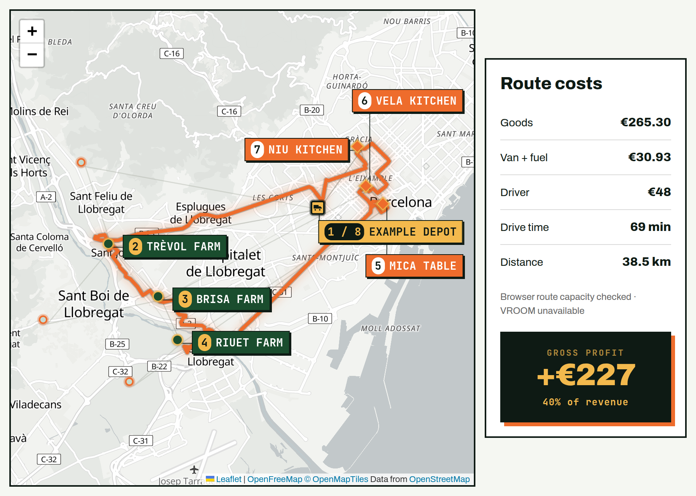

# Farm-to-restaurant route planner

Plan shared farm pickups and restaurant deliveries on actual roads. Compare sourcing choices, inspect each stop and explain goods, van, fuel and driver costs.

The included Barcelona example has **six fictional farms, five fictional restaurants, eight products and six baskets**. Business names, coordinates, inventory, prices and orders were independently authored for this release. Road distances and geometry come from your configured OSRM service; the map retains its own attribution.



[Explore the recorded example](https://latintzar.github.io/farm-to-restaurant-route-planner/demo.html) · [Architecture and decisions](docs/ARCHITECTURE.md) · [Data format](data/README.md)

## Try the example

```sh
python3 -m http.server 8080 --bind 127.0.0.1
```

Open `http://127.0.0.1:8080/demo.html`. The unchanged application calculates one fixed Barcelona basket using recorded road responses. It needs zero live routing or solver calls; the basemap and fonts load normally. The example businesses and rates are fictional. [Recording provenance](demo/README.md).

## Run locally

Requirements: Python 3 for static serving and an OSRM car-routing service covering Barcelona. Node 18+ runs the dependency-free offline tests. VROOM is optional: it attempts a complete pickup/delivery confirmation after the browser selects a sourcing bundle.

```sh
python3 -m http.server 8080 --bind 127.0.0.1
```

Open `http://127.0.0.1:8080`. Local defaults are OSRM at `http://localhost:5000` and VROOM at `http://localhost:3000`. Set the services you operate or are authorized to use in [config.js](config.js); [examples/config.local-services.js](examples/config.local-services.js) is a complete local configuration. Cross-origin services need CORS support. Hosted pages default to same-origin `/osrm` and `/solve`, supplied by the host's reverse proxy.

OSRM must support `/table/v1/driving` with duration and distance annotations for all 12 catalogue locations, and `/route/v1/driving` with GeoJSON geometry. Follow the [upstream OSRM guide](https://project-osrm.org/docs/v5.24.0/api/) to prepare regional map data. [Routing service setup](server/README.md) includes the optional VROOM container.

Choose **scenarios → 3 chefs · 4 items · 250kg**, then **Calculate**. Its scenario ID is `barcelona-multi-stop`: a 250 kg basket delivered to Vela Kitchen, Mica Table and Niu Kitchen. The displayed route uses actual road geometry. An unavailable VROOM service leaves an explicitly browser-checked proposal; a complete validated solver response has its own confirmation status.

The frontend caches one road matrix for the current catalogue, then requests geometry for the chosen route. Use the configured provider according to its service policy; operate your own service for repeated evaluations or shared hosting. The release supplies local endpoints. The basemap, map libraries and fonts need network access or locally hosted replacements.

For agent setup, use [the run skill](skills/run-route-planner/SKILL.md).

## How a proposal is calculated

1. OSRM supplies the road distance/time matrix for the depot, farms and restaurants.
2. The browser enumerates eligible sourcing choices, respecting stock and minimum order quantities (MOQs). When single suppliers cannot cover demand, a bounded split-sourcing fallback considers subsets of up to eight entered suppliers, reserving each supplier's MOQ before allocating the remainder.
3. All generated sourcing bundles are evaluated up to 1,500 bundles. Larger spaces use eight seeded local-search restarts with a 4,000-evaluation budget. Nearest-neighbour and 2-opt order the pickup-first route.
4. Candidates are ranked by goods + fuel + van rental + modeled driver time. The displayed costs use the same objective.
5. One VROOM request attempts to confirm the selected bundle. Every requested pickup/delivery, location, paired precedence, quantity and capacity bound is checked before a cheaper solver ordering can replace the browser result.
6. OSRM supplies road-following geometry for the final stop order.

This is a bounded heuristic search. Exhaustive sourcing enumeration still uses heuristic route ordering. The confirmation concerns the selected bundle, rather than re-ranking every bundle through an external solver.

## Example baskets and assumptions

| Scenario ID | Purpose |
|---|---|
| `small-basket` | One restaurant, two products, 50 kg |
| `barcelona-multi-stop` | Three restaurants, four products, 250 kg |
| `city-wide` | Five restaurants, eight products, 400 kg |
| `split-stock` | 140 kg tomato demand requires two farms |
| `capacity-boundary` | 650 kg, exactly the pickup-first capacity |
| `split-runs` | 651 kg, identified as requiring split runs |

The browser collects all pickups before delivering. The full basket must fit in the vehicle at once. Interleaved pickups/deliveries, multiple vehicles, time windows and cold-chain constraints are outside this search model.

The fictional vehicle assumptions are 650 kg capacity, €0.18/km fuel, €12/hour van rental capped at €72/day, and €24/hour driver time. Each hourly charge rounds `drive hours × 1.35` up to whole hours. [data/depot.json](data/depot.json) owns those editable assumptions. The values were authored on 28 October 2026 as examples; service responses supply travel data rather than commercial quotations.

The Modeling report estimates route shape for scenario comparison. Calculate produces the road-backed proposal and explicit route-check status. Gross profit deducts goods and run costs; add other business overhead to assess net earnings. Optional channel comparisons use illustrative 1.30 delivered-price and 0.79 farm-gate multipliers against the authored reference prices.

## Tests and verification

```sh
npm test
npm run check
```

With Playwright 1.58.0 and its Chromium installed, `python3 tests/browser_demo.py` exercises the recorded example at desktop/phone sizes and blocks every live road-service request.

**17 offline tests pass**: the 16 existing routing/label cases plus fixture validity, reference integrity, stock/MOQ feasibility and intended capacity boundaries. They exercise the application functions with synthetic matrices and solver responses, making zero real routing requests.

The fictional Barcelona fixture has successful live OSRM table and route responses, retained with exact request URLs and hashes. The real app and recorded example pass desktop/phone walkthroughs; the map has seven readable stop labels. Live VROOM/container compatibility remains unverified. [provenance/release-checks.json](provenance/release-checks.json) records these boundaries.

## Code and data

- [app.js](app.js): UI state, sourcing, route search, confirmation and modeled costs.
- [index.html](index.html), [style.css](style.css): responsive interface, map and breakdown.
- [data/README.md](data/README.md): fixture provenance, JSON schema and catalogue replacement.
- [docs/ARCHITECTURE.md](docs/ARCHITECTURE.md): decisions and calculation boundaries.
- [provenance/](provenance/): clean-export provenance and checks.

Peter Neyra's code and newly authored example fixture use the [MIT licence](LICENSE). External software, map tiles and road data retain their terms; see [THIRD_PARTY.md](THIRD_PARTY.md). The historical sourced producer catalogue remains in its private case archive, with the [publisher's redistribution restriction](https://parcagrari.cat/info-legal) recorded in [data provenance](data/README.md).
